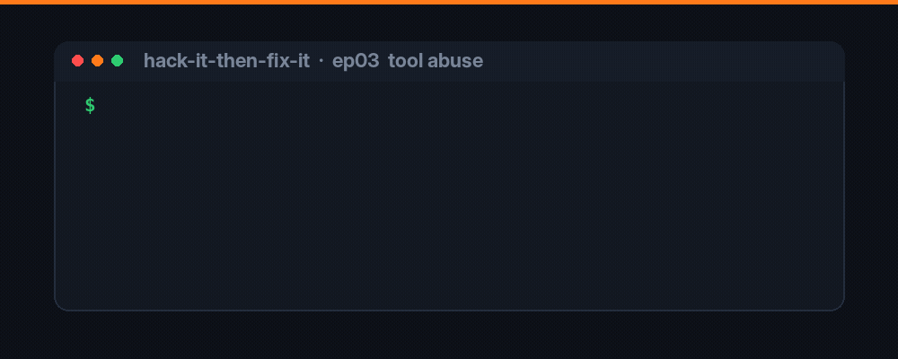

<p align="center">
  
</p>

<h1 align="center">Hack It, Then Fix It</h1>

<p align="center"><b>Hands-on AI security labs.</b> Break a real AI app, see exactly why it broke, then ship the fix — offline, no API key.</p>

<p align="center">
  <a href="https://www.youtube.com/@bugbountybeyond?sub_confirmation=1"><b>▶ Watch the series</b></a> &nbsp;·&nbsp;
  <a href="#labs">Labs</a> &nbsp;·&nbsp;
  <a href="#quickstart">Quickstart</a> &nbsp;·&nbsp;
  <a href="SAFETY.md">Safety</a>
</p>

<p align="center">
   &nbsp;
   &nbsp;
   &nbsp;
  
</p>

---

## What this is

Each episode of the YouTube series ships a small, self-contained lab. Every lab gives you:

- 🔴 a **vulnerable** build you can actually exploit,
- 🟢 the **fixed** build that blocks the same attack,
- ⚔️ an **attack script** that passes against the vuln and fails against the fix.

Fake data, a mock model, runs entirely on your machine. You learn the attack by landing it — then learn the defense by watching it fail.

<a name="quickstart"></a>
## Quickstart

```bash
git clone https://github.com/usinha79/hack-it-then-fix-it
cd hack-it-then-fix-it/ep03-tool-abuse   # any live lab
cat README.md                            # per-lab run steps (usually: pip install -r requirements.txt)
```

Run the **vulnerable** app and fire `./attack.sh` — watch it leak. Switch to the **fixed** app, run the same attack — watch it blocked. That's the whole loop.

<a name="labs"></a>
## Labs — Season 1

> 🟢 Live · ◻️ releasing on its air date (one per day, Mon–Sat, 8 PM IST)

| Ep | Topic | Status |
|----|-------|--------|
| 01 | [Direct prompt injection](ep01-direct-prompt-injection/) | 🟢 **Live** |
| 02 | [Indirect prompt injection](ep02-indirect-prompt-injection/) | 🟢 **Live** |
| 03 | [Tool abuse](ep03-tool-abuse/) | 🟢 **Live** |
| 04 | [RAG data leakage](ep04-rag-data-leakage/) | 🟢 **Live** |
| 05 | [MCP server auth](ep05-mcp-server-auth/) | 🟢 **Live** |
| 06 | [Coding-agent config injection](ep06-coding-agent-config-injection/) | 🟢 **Live** |
| 07 | [Insecure output handling](ep07-insecure-output-handling/) | 🟢 **Live** |
| 08 | [Defense in depth](ep08-defense-in-depth/) | 🟢 **Live** |
| 09 | [Resume injection](ep09-resume-injection/) | 🟢 **Live** |
| 10 | Image prompt injection | ◻️ Nov 23 |
| 11 | Memory poisoning | ◻️ Nov 24 |
| 12 | Multi-agent confused deputy | ◻️ Nov 25 |
| 13 | Browser-agent hijack | ◻️ Nov 26 |
| 14 | Hallucination & misinformation | ◻️ Nov 27 |
| 15 | Agent permission policy | ◻️ Nov 28 |
| 16 | Malicious model file | ◻️ Nov 30 |
| 17 | Slopsquatting | ◻️ Dec 1 |
| 18 | Vector-DB poisoning | ◻️ Dec 2 |
| 19 | Sensitive data in logs | ◻️ Dec 3 |
| 20 | Denial of wallet | ◻️ Dec 4 |
| 21 | AI threat modeling | ◻️ Dec 5 |
| 22 | promptfoo red-team | ◻️ Dec 7 |
| 23 | Guardrails | ◻️ Dec 8 |
| 24 | Attack detection | ◻️ Dec 9 |
| 25 | Semgrep review | ◻️ Dec 10 |
| 26 | Incident response | ◻️ Dec 11 |
| 27 | Season-one CTF | ◻️ Dec 12 |

## The bigger picture

- **Season 1** — the attack toolkit, episode by episode *(now)*
- **Season 2** — real-world AI incidents, reproduced as labs *(Dec 2026)*
- **Season 3** — *AI Red Teaming: the complete hands-on course* *(from Feb 2027)*

## Safety

These labs contain **intentionally vulnerable code and working exploits**, for learning on an isolated machine only. Never point the attacks at systems you don't own. See [SAFETY.md](SAFETY.md).

## Follow along

If a lab helps you, **⭐ star this repo** and **subscribe** — it's how more builders find it.

- ▶ **YouTube:** [@bugbountybeyond](https://www.youtube.com/@bugbountybeyond?sub_confirmation=1) — new lab Mon–Sat, 8 PM IST
- A full attack-and-fix walkthrough for each lab lands on the channel the evening it releases.

## License

[MIT](LICENSE) — use the labs freely to learn and teach.
